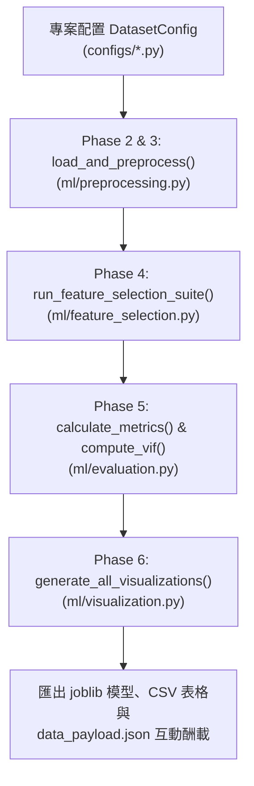

# 多元線性迴歸與特徵選擇雙專案互動分析平台
# Multiple Linear Regression Explorer: Dual-Project Interactive Machine Learning Platform

> 🌐 **線上互動展示網址 (GitHub Pages Live Website):**  
> **[https://chen-fanny.github.io/DIC-2-kaggle-50-startup-and-boston-housing/](https://chen-fanny.github.io/DIC-2-kaggle-50-startup-and-boston-housing/)**
>
> 📦 **GitHub 專案倉庫 (Repository URL):**  
> **[https://github.com/Chen-Fanny/DIC-2-kaggle-50-startup-and-boston-housing](https://github.com/Chen-Fanny/DIC-2-kaggle-50-startup-and-boston-housing)**

本專案為針對期中多元線性迴歸（Multiple Linear Regression）與特徵選擇（Feature Selection）作業之完整、可重現且符合產業標準 **CRISP-DM** 規範之雙專案機器學習系統，具備高可擴展之模組化工作流程（Reusable ML Workflow）與現代化互動式 Web 成果展示平台。

專案完整實作並支援以下兩大多元線性迴歸主題：
- **專案 A (Project A) — 洪水機率預測 (Flood Probability Prediction):** Kaggle Playground Series S4E5 資料集（111.8 萬筆樣本、20 項水文環境特徵）。
- **專案 B (Project B) — 50 家新創企業淨利潤預測 (50 Startups Profit Prediction):** 經典 50 Startups 營運財務資料集（研發支出、管理費用、行銷費用與所在州別 State 單熱編碼）。

> **版面風格與計算機參考聲明：**  
> 本專案互動網頁（`index.html`）之整體版面視覺結構、雙欄卡片佈局（Two-column card layout）、未標準化多元線性迴歸計算機呈現方式與統計診斷面板，**特別參考自 [StatsUnlock Multiple Linear Regression Calculator](https://statsunlock.com/multiple-linear-regression-calculator/)** 的 UI/UX 設計理念，並透過 Inter 現代字體、深淺雙色對比與 Chart.js 向量圖表進行全方位升級。

---

## 專案目錄結構 (Project Structure)

```text
Flood_Prediction/
├── index.html                            # 雙專案整合互動式儀表板（頂部下拉選單即時切換）
├── docs/                                 # GitHub Pages 輕量靜態發布目錄 (Zero-Lag Static Deployment)
│   ├── index.html
│   └── results/                          # 輕量圖表 (PNG) 與實驗結果 JSON 酬載
├── main.py                               # 主執行程式（洪水機率預測全流程）
├── run_startup.py                        # 50 新創企業利潤預測專用執行腳本
├── serve.py                              # 本地互動網頁伺服器（自動開啟瀏覽器）
├── requirements.txt                      # 依賴套件清單
├── README.md                             # 專案繁體中文完整說明文件
├── .github/workflows/deploy-pages.yml    # GitHub Actions 自動部署工作流
├── ml/                                   # 可複用機器學習架構模組 (Reusable ML Workflow)
│   ├── __init__.py
│   ├── config.py                         # 資料集配置資料類別 (DatasetConfig)
│   ├── preprocessing.py                  # 資料載入、虛擬變數單熱編碼與零資料洩漏分割
│   ├── feature_selection.py              # 五大特徵選擇演算法與 k=1..k_max 評估套件
│   ├── evaluation.py                     # 統計指標計算 (R2, RMSE, MAE, MSE)、VIF 與最佳 k 判定
│   ├── visualization.py                  # 300 DPI 研究級論文圖表產生器 (8 大子圖)
│   └── workflow.py                       # CRISP-DM 六大階段統一調度管線 (Orchestrator)
├── configs/                              # 專案資料集配置定義
│   ├── __init__.py
│   ├── flood_config.py                   # 洪水預測專案配置
│   └── startup_config.py                 # 50 新創企業專案配置
├── data/
│   ├── train.csv                         # Kaggle 官方洪水訓練集 (1,117,957 筆)
│   ├── test.csv                          # Kaggle 官方洪水測試集 (745,305 筆)
│   ├── sample_submission.csv             # Kaggle 官方提交格式
│   └── 50_Startups.csv                   # 50 家新創企業原始資料集 (50 筆)
└── results/
    ├── projects_data.json                # 雙專案整合數據酬載 (供前端即時免刷新切換)
    ├── data_payload.json                 # 洪水預測數據酬載
    ├── best_model.joblib                 # 洪水預測最佳模型管線
    ├── submission.csv                    # Kaggle 競賽提交檔
    ├── feature_selection_comparison.csv  # 洪水 5 特徵比較表
    ├── feature_selection_1_to_20.csv     # 洪水 1 至 20 特徵評估曲線數據
    ├── feature_ranking.csv               # 洪水特徵重要性排名總表
    ├── *.png                             # 洪水 8 張 300 DPI 研究圖表
    └── startup/                          # 50 Startups 獨立產出目錄
        ├── startup_model.joblib          # 新創利潤最佳模型管線
        ├── data_payload.json             # 新創預測數據酬載
        ├── experimental_analysis.md      # 新創 CRISP-DM 學術報告 (APA 7th)
        ├── feature_selection_comparison.csv # 新創特徵選擇比較表
        ├── feature_selection_1_to_5.csv  # 新創 1 至 5 特徵評估曲線數據
        ├── feature_ranking.csv           # 新創特徵重要性排名總表
        └── *.png                         # 新創 8 張 300 DPI 研究圖表
```

---

## 一、雙專案主題與資料集介紹 (Two Projects Overview)

### 專案 A — 洪水發生機率預測 (Flood Probability Prediction)
- **資料集來源:** [Kaggle Playground Series S4E5](https://www.kaggle.com/competitions/playground-series-s4e5/data)
- **樣本規模:** 訓練集 1,117,957 筆，獨立外封測試集 223,592 筆（完全隔離）。
- **特徵維度:** 20 個連續數值特徵（季風強度、地形排水、水壩品質、都市化、淤積、氣候變遷等）。
- **目標變數:** `FloodProbability`（0 至 1 連續機率）。
- **核心結論:** 20 項環境變數之迴歸係數高度均勻（$\beta \approx 0.0056$），特徵間近乎完全正交（VIF $\approx 1.0028$），20 個特徵全部保留具備全域最佳解釋力（$R^2 = 0.8456$）。

### 專案 B — 50 家新創企業淨利潤預測 (50 Startups Profit Prediction)
- **資料集來源:** [GitHub harimittapalli/Mulitple-Linear-Reggression](https://raw.githubusercontent.com/harimittapalli/Mulitple-Linear-Reggression/master/50_Startups.csv)
- **樣本規模:** 50 筆真實新創企業財務營運樣本。
- **輸入變數:**
  1. `R&D Spend`: 研發支出（連續型數值，美元）
  2. `Administration`: 管理費用（連續型數值，美元）
  3. `Marketing Spend`: 市場行銷推廣支出（連續型數值，美元）
  4. `State`: 企業登記州別（類別型：`California`, `Florida`, `New York`）
- **類別單熱編碼與虛擬變數陷阱防範:**
  - 採用加州 `California` 作為基準參考組（Reference Category，令 $D_{\text{FL}} = 0, D_{\text{NY}} = 0$）。
  - 編碼後新增 2 個虛擬指示變數：`State_Florida` 與 `State_New York`。
  - 最終模型輸入維度為 5 個特徵。
- **目標變數:** `Profit`（連續淨利潤，美元）。
- **真實 OLS 迴歸方程式:**
  $$\widehat{\text{Profit}} = \$50,125.34 + 0.8060 \cdot (\text{R\&D}) - 0.0270 \cdot (\text{Admin}) + 0.0270 \cdot (\text{Marketing}) + \$198.79 \cdot D_{\text{FL}} - \$41.89 \cdot D_{\text{NY}}$$

---

## 二、可複用機器學習工作流程 (Reusable CRISP-DM Workflow)

本專案將機器學習核心演算法與資料集特性完全解耦（Decoupled Architecture），抽取出通用的 `ml` 模組：



### 如何套用至未來的第三個迴歸資料集？ (Extensibility Guide)
欲將本工作流程應用於未來的第三個迴歸題目（例如波士頓房價、汽車油耗預測），僅需三步驟，**完全無須修改演算法程式碼**：

1. **建立新資料集配置檔 `configs/housing_config.py`:**
```python
from ml.config import DatasetConfig

housing_config = DatasetConfig(
    name="Boston Housing Price Prediction",
    project_id="housing",
    data_path="data/housing.csv",
    target_col="MEDV",
    categorical_features=["CHAS"],
    reference_categories={"CHAS": "0"},
    k_max=13,
    exhaustive_k_max=5,
    output_dir="results/housing",
    model_filename="housing_model.joblib",
    unit_symbol="$",
    target_name_zh="房屋中位價 (千美元)"
)
```
2. **在 Python 腳本中一鍵呼叫執行管線:**
```python
from configs.housing_config import housing_config
from ml.workflow import run_crisp_dm_pipeline

# 自動完成資料分割、標準化、5 大演算法特徵篩選、300 DPI 圖表與 APA 報告產出
payload = run_crisp_dm_pipeline(housing_config)
```

---

## 三、網站核心特色與頂部下拉專案切換 (Header Project Dropdown)

本平台在網站頁首（Header）設有醒目的**專案下拉選單**，提供零延遲、平滑過渡的雙專案切換體驗：

### 1. 雙專案切換連動範圍
當使用者在頁首切換 `🌊 Flood Probability Prediction` 與 `🚀 50 Startups Profit Prediction` 時，全站所有元件同步即時更新：
- **頂部狀態欄:** 更新樣本數、資料集標題與全模型指標。
- **計算機面板 (Tab 1):** 自動置換輸入欄位（洪水 20 項環境滑桿 vs 新創 3 大財務滑桿 + 州別下拉選單），更新未標準化迴歸方程式與邊際貢獻度拆解。
- **五大演算法對比 (Tab 2):** 載入該專案之橫向指標評估表與 Chart.js 動態長條圖。
- **特徵數量選擇器 (k Controller):** 動態調整拉桿上限（洪水 1-20 vs 新創 1-5），並展示該演算法之最佳甜點 (★)。
- **特徵遞增曲線 (Tab 3):** 重新繪製 Graph A (RMSE) 與 Graph B ($R^2$) 折線圖，星號標註最佳甜點，支援點擊圖表數據點即時選取 $k$。
- **圖表展示館 (Tab 4):** 圖片路徑動態切換至對應專案的 8 張 300 DPI 原生分析圖表。
- **學術分析報告 (Tab 5):** 動態切換完整的 APA 第七版報告與 VIF 診斷陳述（包含加州參考組解讀）。

---

## 四、互動式特徵數量 ($k$) 選擇器與最佳甜點分析 (Interactive k Selection)

為滿足隨機探索特徵維度之需求，本系統不局限於展示固定最佳解，而是允許使用者自由選取任意 $k$ 值：

### 1. 控制器介面
- **演算法切換按鈕:** 自由切換 `🔴 Lasso L1`、`🔵 Forward SFS`、`🟢 RFE`、`🟡 ElasticNet` 與 `🟣 Exhaustive Search`。
- **連續拖曳拉桿與數值方塊:** 即時調整 $k$。
- **最佳甜點高亮標籤:** 系統依據最小驗證集 RMSE（平手時優先取較小特徵數之 Tie-breaking 規則）動態標註 `★ Optimal Sweet Spot`。

### 2. 當選取 $k$ 非最佳甜點時之對比呈現
例如在新創專案中，RFE 最佳甜點為 $k=3$，若使用者拉至 $k=5$：
- 狀態看板即時標示：
  - **當前選取 (Selected):** $k = 5$（RMSE: \$9,794.97, $R^2$: 0.9539）
  - **最佳甜點 (Optimal):** $k = 3 \ ★$（RMSE: \$8,857.98, $R^2$: 0.9623）
  - 清楚區分兩者數值差異，不將次佳解誤標為最佳解。
- 動態列出當前 $k$ 演算法挑選之具體特徵子集清單。

---

## 五、雙專案實驗成果詳細數據對比 (Experimental Evaluation Results)

### 1. 專案 A (洪水機率預測 - Kaggle S4E5)
- **最佳模型:** Baseline (All 20 Features)
- **驗證指標:** $R^2 = 0.84565$, $\text{RMSE} = 0.02007$, $\text{MAE} = 0.01580$
- **獨立 20% 外封測試集:** $R^2 = 0.84488$, $\text{RMSE} = 0.02008$
- **VIF 多元共線性:** 20 個特徵之 VIF 介於 1.0017 至 1.0036 之間（平均 1.0028），特徵間近乎完全獨立。

| 演算法 (5 特徵限制) | 特徵數 k | 選出核心特徵子集 | 驗證集 RMSE | 決定係數 R² |
|---|---|---|---|---|
| **Forward SFS** | 5 | TopographyDrainage, MonsoonIntensity, ClimateChange, Siltation, DamsQuality | 0.04623 | 0.18133 |
| **Exhaustive Search** | 5 | MonsoonIntensity, TopographyDrainage, ClimateChange, DamsQuality, Siltation | 0.04623 | 0.18133 |
| **RFE 遞迴淘汰** | 5 | RiverManagement, Siltation, TopographyDrainage, DamsQuality, Landslides | 0.04627 | 0.18012 |
| **Lasso (L1)** | 5 | CoastalVulnerability, TopographyDrainage, PoliticalFactors, PopulationScore, Urbanization | 0.04636 | 0.17687 |
| **ElasticNet** | 5 | CoastalVulnerability, TopographyDrainage, PoliticalFactors, PopulationScore, Urbanization | 0.04636 | 0.17687 |
| **Baseline (全特徵)** | **20** | **全部 20 項水文環境與治理變數** | **0.02007** | **0.84565** |

---

### 2. 專案 B (50 Startups 新創企業淨利潤預測)
- **最佳模型:** RFE 遞迴淘汰 ($k = 3$)
- **選出核心特徵:** `R&D Spend`, `Marketing Spend`, `Administration`
- **驗證指標:** $R^2 = 0.96234$, $\text{RMSE} = \$8,857.98$, $\text{MAE} = \$7,718.24$
- **獨立 20% 外封測試集 (N=10):** $R^2 = 0.90007$, $\text{Adj } R^2 = 0.85010$, $\text{RMSE} = \$8,995.91$, $\text{MAE} = \$6,979.15$
- **VIF 檢驗:** Marketing Spend (2.15), R&D Spend (2.07), State_FL (1.35), State_NY (1.31), Admin (1.20)，全部遠低於 5.0。

| 演算法名稱 | 最佳甜點 k | 選出核心特徵清單 | 驗證集 RMSE | 決定係數 R² |
|---|---|---|---|---|
| **RFE 遞迴淘汰 (全域最佳)** | **3 ★** | **R&D Spend, Marketing Spend, Administration** | **$8,857.98** | **0.96234** |
| **Forward SFS** | 2 | R&D Spend, Marketing Spend | $9,122.84 | 0.96005 |
| **Exhaustive Search** | 2 | R&D Spend, Marketing Spend | $9,122.84 | 0.96005 |
| **Lasso (L1)** | 2 | R&D Spend, Marketing Spend | $9,122.84 | 0.96005 |
| **ElasticNet** | 2 | R&D Spend, Marketing Spend | $9,122.84 | 0.96005 |
| **Baseline (全特徵)** | 5 | 全部 5 項特徵 (含 State_Florida, State_New York) | $9,794.97 | 0.95395 |

---

## 六、安裝與本機啟動指南 (Installation & Execution)

### 1. 安裝環境套件
```bash
cd Flood_Prediction
pip install -r requirements.txt
```

### 2. 重新執行機器學習實驗 (可選)
- 執行專案 A (洪水預測全流程):
  ```bash
  python main.py
  ```
- 執行專案 B (50 Startups 利潤預測全流程):
  ```bash
  python run_startup.py
  ```

### 3. 一鍵啟動雙專案互動網頁伺服器 (推薦)
```bash
python serve.py
```
> 執行後本機將啟動 HTTP 伺服器並自動開啟瀏覽器前往 `http://localhost:8000/index.html`。
> 亦可直接在 Windows 檔案總管中雙擊 `index.html` 進行離線操作（所有數據與圖表已完整內嵌，無任何跨來源限制問題）。

---

## 七、GitHub Pages 部署與線上瀏覽指南 (GitHub Pages Deployment)

本專案已完全優化支援 GitHub Pages 靜態網站自動化部署：

### 1. 線上公開存取網址 (Live Public URL)
- **GitHub Pages 線上互動網址:** [https://chen-fanny.github.io/DIC-2-kaggle-50-startup-and-boston-housing/](https://chen-fanny.github.io/DIC-2-kaggle-50-startup-and-boston-housing/)
- **GitHub 專案倉庫:** [https://github.com/Chen-Fanny/DIC-2-kaggle-50-startup-and-boston-housing](https://github.com/Chen-Fanny/DIC-2-kaggle-50-startup-and-boston-housing)

### 2. 靜態發布架構說明
為符合 GitHub 倉庫檔案大小限制與極速載入需求，本專案採取「**模型運算與靜態發布分離**」架構策略：
1. **龐大訓練數據隔離:** 百萬筆 Kaggle 訓練集 (`train.csv` >56MB, `test.csv` >34MB, `submission.csv` ~20MB) 與本機 `.joblib` 二進位模型檔案已透過 `.gitignore` 排除，保持 GitHub 倉庫輕量快速 (<5MB)。
2. **零延遲數據酬載:** 所有模型推論權重、評估指標、特徵選擇曲線與 8 大 300 DPI 視覺化圖表均完整收錄於 `docs/` 目錄與 `results/` 中，開箱即用。
3. **雙重部署管道支援:**
   - **管道 A (GitHub Actions 自動建置 - 推薦):** 倉庫內建 `.github/workflows/deploy-pages.yml`，每當推送到 `main` 分支時自動部署。
   - **管道 B (Branch /docs 發布):** 在 GitHub 倉庫的 `Settings` -> `Pages` -> `Source` 選擇 `Deploy from a branch` -> `main` 分支 -> `/docs` 資料夾即可直接部署。

